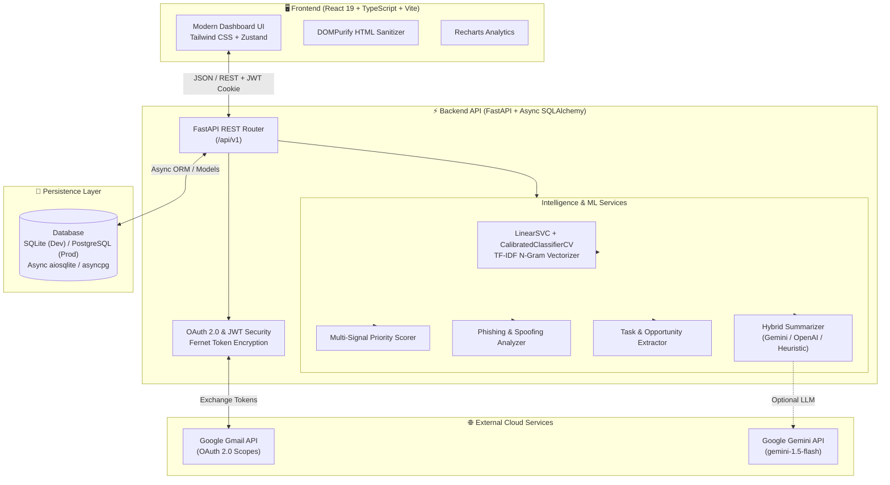
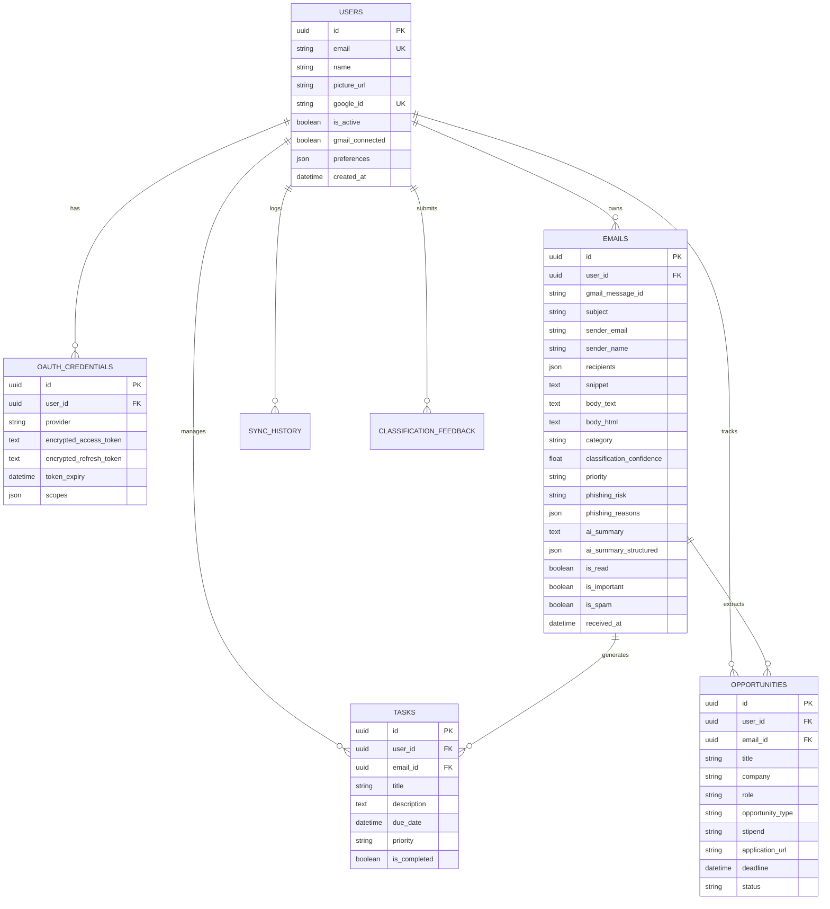

# 📬 MailMind AI

<h3 align="center">Your inbox, intelligently understood.</h3>

<p align="center">
  A production-grade, full-stack AI Email Intelligence and Career Productivity Platform.<br />
  Combines calibrated machine learning, automated opportunity extraction, multi-signal priority detection, phishing defense, and modern UI/UX to transform inbox overload into structured, actionable intelligence.
</p>

<p align="center">
  <a href="#-key-features"></a>
  <a href="#-technology-stack"></a>
  <a href="#-technology-stack"></a>
  <a href="#-technology-stack"></a>
  <a href="#-technology-stack"></a>
  <a href="#-technology-stack"></a>
  <a href="#-license"></a>
</p>

---

## 📑 Table of Contents

- [Overview & Problem Statement](#-overview--problem-statement)
- [Key Features](#-key-features)
- [System Architecture](#-system-architecture)
- [Machine Learning Pipeline](#-machine-learning-pipeline)
- [Database Schema & Data Models](#-database-schema--data-models)
- [REST API Reference](#-rest-api-reference)
- [Technology Stack](#-technology-stack)
- [Installation & Quick Start](#-installation--quick-start)
  - [Option 1: One-Click Quick Start (Windows)](#option-1-one-click-quick-start-windows)
  - [Option 2: VS Code Task Runner](#option-2-vs-code-task-runner)
  - [Option 3: Manual Terminal Setup](#option-3-manual-terminal-setup)
- [Google OAuth 2.0 Configuration](#-google-oauth-20-configuration)
- [Environment Variables](#-environment-variables)
- [Testing & Quality Assurance](#-testing--quality-assurance)
- [Security & Privacy Blueprint](#-security--privacy-blueprint)
- [Project Directory Structure](#-project-directory-structure)
- [License & Contributing](#-license--contributing)

---

## 💡 Overview & Problem Statement

The average student, researcher, or professional receives **120+ emails every day**. For students and job seekers in particular, inboxes are flooded with a chaotic mix of:
- **Academic notices**: Exam timetables, curriculum revisions, faculty announcements.
- **Career opportunities**: Internships, placement drives, hackathons, and fellowship deadlines.
- **Financial reminders**: Fee deadlines, scholarship disbarments, stipend forms.
- **Security threats**: Coercive phishing links and brand-spoofed credential harvesters.
- **Promotional noise**: Automated newsletters and irrelevant marketing blasts.

Manually sorting, tagging, and following up on every message leads to missed career deadlines, lost opportunities, and cognitive fatigue.

**MailMind AI** solves this problem end-to-end. It connects securely to Gmail via Google OAuth 2.0, ingests and deduplicates emails, classifies them into **9 specialized categories** using a calibrated ML model, computes a multi-signal priority rating, detects potential phishing threats, extracts tasks and application deadlines, and renders actionable summaries inside a dashboard designed with React and Tailwind CSS.

---

## ✨ Key Features

### 🧠 Calibrated ML Email Classifier
- **9-Class Specialized Taxonomy**: Normalized categories covering Academic, Administration, Campus Service, Career and Opportunity, Financial Services, Service Notification, Scholarship, Skill Development, and Miscellaneous.
- **Calibrated Probabilities**: Uses `CalibratedClassifierCV` with sigmoid calibration on top of a `LinearSVC` + `TfidfVectorizer` pipeline to generate genuine confidence scores rather than uncalibrated margin distances.
- **Feature Explainability**: Identifies the top TF-IDF n-grams that triggered the prediction, providing transparent classification reasoning for every email.

### ⚡ Smart Multi-Signal Priority Engine
- Evaluates urgency, sender authority, imminent deadlines, and category weights across four tiers:
  - 🔴 **Critical**: Urgent action required, deadlines within 24–48 hours, or official administration summons.
  - 🟠 **High**: Important career opportunities, scheduled interviews, and scholarship notifications.
  - 🟡 **Medium**: General academic coursework, team updates, and regular notifications.
  - ⚪ **Low**: Newsletters, promotional circulars, and system notifications.

### 🎓 Career & Student Intelligence Module
- Automatically mines emails for career advancements: **Internships, Job Openings, Hackathons, Placements, and Scholarships**.
- Extracts company names, job roles, stipend/compensation, work mode (remote/onsite), eligibility criteria, application links, and deadlines.
- Dedicated **Kanban/Status Tracking funnel**: `New` → `Saved` → `Applied` → `Assessment` → `Interview` → `Offer` / `Rejected`.

### 📋 Automated Task & Deadline Extraction
- Detects action verbs, explicit deadlines, and assignment commitments from unstructured message bodies.
- Converts emails into manageable tasks with due dates, priority tags, and completion checkboxes.

### 🛡️ Heuristic Phishing & Spoofing Defense
- **Explainable Threat Analysis**: Evaluates sender display-name mismatches, lookalike domains, suspicious TLDs, IP-based URLs, and psychological urgency tactics.
- Categorizes risk into `None`, `Low`, `Medium`, and `High` with explicit bulleted rationale before the user clicks any embedded links.

### 🤖 Hybrid AI Summarizer & Smart Reply
- **Executive Summaries**: Produces a synthesized briefing with key points, required actions, and deadlines.
- **Dual-Engine Flexibility**: Connects to **Google Gemini 1.5 Flash** or **OpenAI GPT-4o-mini** when API keys are provided.
- **Offline Fallback Guarantee**: If no API keys are present, MailMind automatically switches to a built-in rule-based heuristic extraction engine with zero external dependencies.
- **Context-Aware Smart Replies**: Drafts professional, friendly, or decline responses ready for 1-click clipboard copying (never auto-sends without user confirmation).

### 📊 Real-Time Analytics Dashboard
- Interactive charts powered by **Recharts**:
  - Email category distribution breakdown.
  - Priority matrix visualizer.
  - 7-day email volume and sync activity tracker.
  - Career opportunity conversion pipeline.
- All metrics are computed dynamically from database queries (zero hardcoded values).

---

## 🏗️ System Architecture



---

## 🧠 Machine Learning Pipeline

```
Raw Email Input (Subject + Body Text)
                 │
                 ▼
       Text Preprocessing
  - Whitespace & HTML entity cleanup
  - Lowercase normalization
                 │
                 ▼
       TF-IDF Vectorization
  - max_features: 10,000
  - ngram_range: (1, 2) [unigrams + bigrams]
  - sublinear_tf: True (logarithmic scaling)
                 │
                 ▼
       LinearSVC Classifier
  - C: 1.0, max_iter: 2000
                 │
                 ▼
    CalibratedClassifierCV
  - Method: Sigmoid (Platt Scaling)
  - Cross-validation: 3-fold stratified
                 │
                 ▼
       Classification Output
  - category: Argmax class label (1 of 9)
  - confidence: Calibrated probability [0.0, 1.0]
  - top_terms: Explanatory TF-IDF feature n-grams
  - is_needs_review: True if confidence < 0.45
```

### Taxonomy & Categories

| # | Category | Scope & Examples |
|---|:---|:---|
| 1 | **Academic** | Course registration, lecture slides, syllabus updates, exam timetables, grade cards. |
| 2 | **Administration** | University circulars, ID card issuance, fee compliance, hostel regulations, registrar notices. |
| 3 | **Campus Service** | Library book returns, cafeteria schedules, sports complex booking, Wi-Fi maintenance. |
| 4 | **Career and Opportunity** | Job postings, summer internships, campus placements, hackathons, coding contests. |
| 5 | **Financial Services** | Bank alerts, tuition receipts, payment reminders, student loan updates, refund notices. |
| 6 | **Scholarship** | Government bursaries, merit scholarships, fellowship grants, endowment applications. |
| 7 | **Skill Development** | Technical workshops, bootcamps, guest lectures, certifications, seminar registrations. |
| 8 | **Service Notification** | Password resets, 2FA codes, account verifications, cloud service quotas, subscriptions. |
| 9 | **Miscellaneous** | Newsletters, club invitations, social events, surveys, general campus buzz. |

---

## 💾 Database Schema & Data Models

MailMind AI enforces strict multi-tenant data isolation. Every record is bound to a foreign key pointing to `users.id`.



---

## 🔌 REST API Reference

Interactive OpenAPI Swagger documentation is available at `http://localhost:8000/docs`.

### Authentication & User Account
| Method | Endpoint | Description |
|:---|:---|:---|
| `GET` | `/api/v1/auth/google/authorize` | Generates CSRF state and returns Google OAuth 2.0 authorization URL |
| `GET` | `/api/v1/auth/google/callback` | Exchanges authorization code for tokens, encrypts credentials, creates session |
| `POST` | `/api/v1/auth/dev-login` | 1-click developer & demo access as "Alex Morgan" with pre-seeded data |
| `GET` | `/api/v1/auth/me` | Returns current authenticated user profile |
| `POST` | `/api/v1/auth/logout` | Clears HTTP-only session cookies |
| `DELETE` | `/api/v1/auth/account` | Permanently deletes account, revokes OAuth tokens, and purges all data |

### Gmail Integration & Sync
| Method | Endpoint | Description |
|:---|:---|:---|
| `POST` | `/api/v1/gmail/connect` | Initiates Gmail connection handshake |
| `DELETE` | `/api/v1/gmail/disconnect` | Revokes Google access and disconnects mailbox |
| `POST` | `/api/v1/gmail/sync` | Triggers background synchronization, ML classification, and entity extraction |
| `GET` | `/api/v1/gmail/sync/status` | Returns latest synchronization progress and metrics |

### Emails & Intelligence
| Method | Endpoint | Description |
|:---|:---|:---|
| `GET` | `/api/v1/emails/` | Paginated email listing with category, priority, search, and status filters |
| `GET` | `/api/v1/emails/{id}` | Detailed email payload with full body, AI briefing, tasks, and phishing audit |
| `PATCH` | `/api/v1/emails/{id}/read` | Updates read/unread state and synchronizes with Gmail labels |
| `PATCH` | `/api/v1/emails/{id}/important` | Toggles important flag |
| `PATCH` | `/api/v1/emails/{id}/spam` | Marks email as spam |
| `POST` | `/api/v1/emails/{id}/summarize` | Generates on-demand executive summary with key points and action items |
| `POST` | `/api/v1/emails/{id}/reply` | Generates context-aware smart reply drafts across multiple tones |
| `POST` | `/api/v1/emails/{id}/feedback` | Logs user category corrections for continuous ML model refinement |

### Career Opportunities & Tasks
| Method | Endpoint | Description |
|:---|:---|:---|
| `GET` | `/api/v1/opportunities/` | Retrieves extracted student opportunities with filter support |
| `PATCH` | `/api/v1/opportunities/{id}/status` | Updates opportunity status (`new`, `applied`, `interview`, `offer`, etc.) |
| `GET` | `/api/v1/tasks/` | Retrieves all extracted and user-created tasks |
| `POST` | `/api/v1/tasks/` | Creates a new standalone task |
| `PATCH` | `/api/v1/tasks/{id}/complete` | Toggles task completion status |

### Analytics
| Method | Endpoint | Description |
|:---|:---|:---|
| `GET` | `/api/v1/analytics/summary` | Top-level counts: total emails, unread count, opportunities, active tasks |
| `GET` | `/api/v1/analytics/category-distribution`| Email distribution counts across all 9 categories |
| `GET` | `/api/v1/analytics/priority-distribution`| Volume breakdown by Critical, High, Medium, Low |
| `GET` | `/api/v1/analytics/weekly-activity` | 7-day chronological email ingestion history |

---

## 💻 Technology Stack

### Backend
- **Language**: Python 3.12+ (compatible with Python 3.14)
- **Framework**: [FastAPI](https://fastapi.tiangolo.com/) with asynchronous route handlers
- **Server**: [Uvicorn](https://www.uvicorn.org/) (ASGI server)
- **Database ORM**: [SQLAlchemy 2.0](https://www.sqlalchemy.org/) (Async Engine)
- **Database Drivers**: `aiosqlite` (built-in local dev) & `asyncpg` (PostgreSQL production)
- **Machine Learning**: `scikit-learn`, `joblib`, `numpy`, `scipy`
- **Security & Crypto**: `cryptography` (Fernet symmetric encryption), `python-jose` (JWT), `passlib`
- **External APIs**: `google-api-python-client`, `google-auth`, `google-generativeai`, `httpx`

### Frontend
- **Framework**: [React 19](https://react.dev/) + [TypeScript](https://www.typescriptlang.org/)
- **Bundler & Tooling**: [Vite](https://vite.dev/)
- **Styling**: [Tailwind CSS](https://tailwindcss.com/) with full Dark/Light theme support
- **State Management**: [Zustand](https://github.com/pmndrs/zustand)
- **Routing**: [React Router v7](https://reactrouter.com/)
- **Data Visualization**: [Recharts](https://recharts.org/)
- **Icons**: [Lucide React](https://lucide.dev/)
- **HTML Sanitization**: [DOMPurify](https://github.com/cure53/DOMPurify)

---

## 🚀 Installation & Quick Start

### Option 1: One-Click Quick Start (Windows)
The easiest way to launch both frontend and backend simultaneously:

1. Double-click **`start.bat`** (or right-click `start.ps1` → **Run with PowerShell**).
2. The launcher will automatically start:
   - FastAPI Backend at **[http://localhost:8000](http://localhost:8000)**
   - Vite React Frontend at **[http://localhost:5173](http://localhost:5173)**
3. Open your browser to **[http://localhost:5173](http://localhost:5173)**.
4. Click **"Explore with Demo Account"** for instant 1-click access with simulated email intelligence!

---

### Option 2: VS Code Task Runner
Pre-configured tasks are provided in `.vscode/tasks.json`:

1. Open the project folder in VS Code (`File` → `Open Folder...`).
2. Press `Ctrl + Shift + P` (or `Cmd + Shift + P` on macOS) to open the Command Palette.
3. Type **`Tasks: Run Task`** and press `Enter`.
4. Select **`Run MailMind AI (Both Servers)`**.
5. Both servers run concurrently inside your integrated VS Code terminals.

---

### Option 3: Manual Terminal Setup

#### Prerequisites
- **Python 3.12+**
- **Node.js 20+**
- **Git**

#### 1. Backend Setup
```bash
# Navigate to backend directory
cd backend

# Create and activate virtual environment
python -m venv .venv
# On Windows:
.venv\Scripts\activate
# On macOS/Linux:
source .venv/bin/activate

# Install dependencies
pip install -r requirements.txt

# (Optional) Retrain the ML Classifier Model if needed
python ml/train.py

# Launch FastAPI development server
python -m uvicorn app.main:app --reload --host 127.0.0.1 --port 8000
```
> The API will be active at `http://127.0.0.1:8000` with Swagger docs at `http://127.0.0.1:8000/docs`.

#### 2. Frontend Setup
```bash
# In a new terminal, navigate to frontend directory
cd frontend

# Install npm dependencies
npm install

# Start Vite development server
npm run dev
```
> The frontend will be active at `http://localhost:5173`.

---

## 🔑 Google OAuth 2.0 Configuration

MailMind connects to your live mailbox using Google's official OAuth 2.0 API. To connect your personal Gmail account:

1. Go to the **[Google Cloud Console](https://console.cloud.google.com/)**.
2. Create a new project (e.g. `MailMind-AI`).
3. Navigate to **APIs & Services → Library**, search for **Gmail API**, and click **Enable**.
4. Configure the **OAuth consent screen**:
   - User Type: **External**.
   - App information: Name: `MailMind AI`, User support email: your email.
   - Scopes: Add `.../auth/userinfo.email`, `.../auth/userinfo.profile`, `openid`, `.../auth/gmail.readonly`, and `.../auth/gmail.modify`.
   - **Test Users**: Under Test users, click **`+ ADD USERS`** and add your personal Gmail address (e.g. `yourname@gmail.com`).
5. Go to **APIs & Services → Credentials**:
   - Click **`+ CREATE CREDENTIALS`** → **OAuth client ID**.
   - Application type: **Web application**.
   - **Authorized JavaScript origins**:
     ```text
     http://localhost:5173
     ```
   - **Authorized redirect URIs**:
     ```text
     http://localhost:8000/api/v1/auth/google/callback
     ```
6. Copy your **Client ID** and **Client Secret**, and paste them into your `.env` file:
   ```env
   GOOGLE_CLIENT_ID=your-client-id.apps.googleusercontent.com
   GOOGLE_CLIENT_SECRET=your-client-secret
   ```
7. Sign in at `http://localhost:5173/login` using **"Continue with Google"**. On the Google unverified screen, click **Advanced** → **Go to MailMind AI (unsafe)** to enter your dashboard.

---

## ⚙️ Environment Variables

Copy `.env.example` to `.env` in the project root:

| Variable | Default Value | Description |
|:---|:---|:---|
| `APP_ENV` | `development` | Environment mode (`development` or `production`) |
| `APP_NAME` | `MailMind AI` | Application title |
| `APP_HOST` | `0.0.0.0` | API bind address |
| `APP_PORT` | `8000` | API port |
| `APP_DEBUG` | `true` | Enables detailed SQL logging and debug handlers |
| `DATABASE_URL` | `sqlite+aiosqlite:///./mailmind.db` | Async database URL. Use `postgresql+asyncpg://...` for PostgreSQL |
| `CORS_ORIGINS` | `["http://localhost:5173"]` | Authorized frontend origins |
| `APP_SECRET_KEY` | *(32-char string)* | Core application key used for cryptographic derivation |
| `JWT_SECRET_KEY` | *(32-char string)* | Secret key used to sign JWT session tokens |
| `JWT_ACCESS_TOKEN_EXPIRE_MINUTES` | `60` | Lifespan of access tokens |
| `ENCRYPTION_KEY` | *(Fernet key)* | Fernet key for encrypting OAuth tokens at rest |
| `GOOGLE_CLIENT_ID` | `""` | Google Cloud OAuth 2.0 Web Client ID |
| `GOOGLE_CLIENT_SECRET`| `""` | Google Cloud OAuth 2.0 Client Secret |
| `GOOGLE_REDIRECT_URI` | `http://localhost:8000/api/v1/auth/google/callback` | OAuth redirect URI matching Google Console |
| `AI_PROVIDER` | `gemini` | Summarizer provider: `gemini`, `openai`, or empty (heuristic) |
| `GEMINI_API_KEY` | `""` | Optional Google AI Studio API key |
| `OPENAI_API_KEY` | `""` | Optional OpenAI API key |
| `ML_MODEL_PATH` | `ml/artifacts/model_v1.pkl` | Location of trained scikit-learn model bundle |
| `ML_CONFIDENCE_THRESHOLD` | `0.45` | Minimum confidence required before triggering review flag |

---

## 🧪 Testing & Quality Assurance

MailMind AI includes automated test suites verifying critical business logic and system behavior:

```bash
cd backend
python -m pytest tests/ -v
```

### Verified Test Suites
- **`tests/test_classifier.py`**:
  - Model bundle loading and deserialization.
  - Multi-class email prediction and confidence boundary checks ($0.0 \le c \le 1.0$).
  - Semantic scholarship and career classification assertions.
- **`tests/test_priority.py`**:
  - Critical priority calculation on urgent administrative deadlines.
  - Low priority classification for promotional newsletters and digests.
- **`tests/test_phishing.py`**:
  - Detection of spoofed display names with domain mismatches.
  - Legitimate academic email pass-through without false positives.
- **`tests/test_api.py`**:
  - Server health endpoint response validation.
  - Development mock login token generation.
  - Authentication guard enforcement on protected routes (HTTP 401).

---

## 🔒 Security & Privacy Blueprint

- **Zero Password Storage**: Uses standard Google OAuth 2.0 tokens; user passwords never touch the server.
- **Token Encryption at Rest**: Access and Refresh tokens are encrypted using **Fernet symmetric encryption** (`cryptography` library) before database insertion.
- **Multi-Tenant Row-Level Isolation**: Every SQL query filters strictly by `user_id == current_user.id`. IDOR-proof by design.
- **Strict HTML Sanitization**: Email HTML bodies are sanitized via **DOMPurify** with strict element and attribute allowlists, stripping `script`, `iframe`, and malicious tracking payloads.
- **Defensive API Architecture**: Rate limiting, strict CORS origin controls, and HTTP-only SameSite cookies protect against CSRF and session hijacking.

---

## 📁 Project Directory Structure

```text
Mailmind/
├── .vscode/                   # VS Code launch & background tasks configuration
│   ├── launch.json
│   └── tasks.json
├── backend/                   # FastAPI Python Application
│   ├── app/
│   │   ├── api/               # REST API route handlers
│   │   │   ├── analytics.py
│   │   │   ├── auth.py
│   │   │   ├── emails.py
│   │   │   ├── gmail.py
│   │   │   ├── opportunities.py
│   │   │   ├── settings.py
│   │   │   └── tasks.py
│   │   ├── core/              # Config, security, logging, OAuth
│   │   ├── database/          # SQLAlchemy async connection & Base
│   │   ├── models/            # Database entity models
│   │   ├── schemas/           # Pydantic v2 schemas
│   │   ├── services/          # Classifier, extraction, summarizer, phishing
│   │   └── utils/
│   ├── ml/                    # Machine learning pipeline
│   │   ├── artifacts/         # Trained model bundle (model_v1.pkl)
│   │   ├── data/              # Curated email dataset
│   │   ├── predict.py         # Inference engine & explainability
│   │   └── train.py           # Training script (TF-IDF + LinearSVC + CalibratedClassifierCV)
│   ├── tests/                 # Automated pytest test suites
│   ├── requirements.txt       # Python dependencies
│   └── pytest.ini
├── frontend/                  # React 19 + TypeScript + Vite Application
│   ├── src/
│   │   ├── components/        # UI components (emails, badges, modals, charts)
│   │   ├── hooks/             # Custom React hooks (useAuth, useEmails)
│   │   ├── pages/             # Route views (Inbox, Analytics, Opportunities, Tasks)
│   │   ├── services/          # Axios API client
│   │   ├── types/             # TypeScript type definitions
│   │   └── utils/             # Sanitization, date formatting, helpers
│   ├── package.json
│   ├── tailwind.config.js
│   └── vite.config.ts
├── docker-compose.yml         # Containerized production stack (PostgreSQL + API + Web)
├── start.bat                  # 1-Click Windows Batch launcher
├── start.ps1                  # 1-Click Windows PowerShell launcher
├── .env                       # Environment variables configuration
└── README.md                  # Project documentation
```

---

## 📄 License & Contributing

Distributed under the **MIT License**. See `LICENSE` for more information.

Contributions, issues, and feature requests are welcome!
Feel free to open an issue or submit a Pull Request.

<p align="center">
  Made with ❤️ by Sneha • Built with FastAPI, React 19 & Scikit-Learn
</p>
